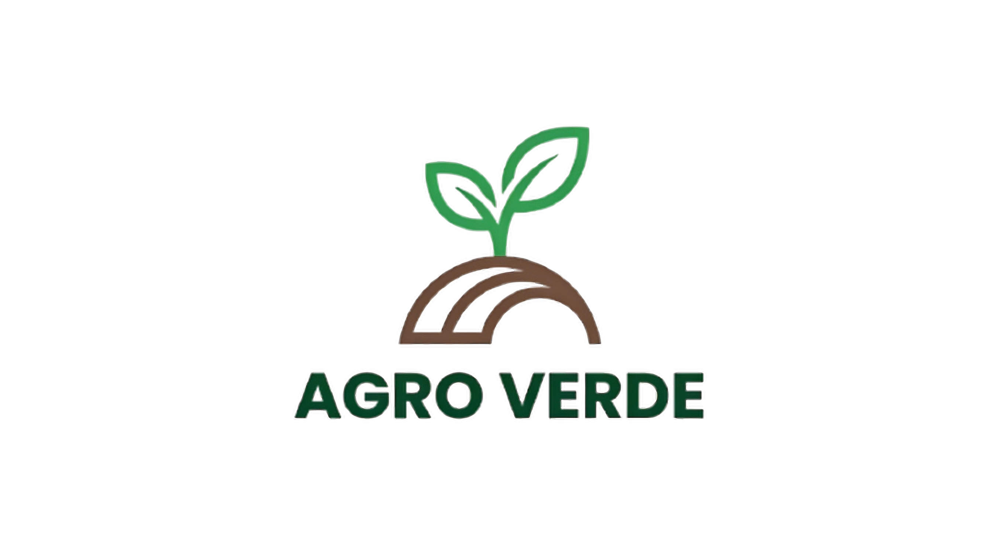

# AgroVerde

Sistema para la gestión de terrenos, cultivos, sanidad vegetal e inventario agrícola del Centro Agropecuario del SENA.

Agro Verde es una aplicación web *mobile-first* y responsiva que sirve para llevar el control de los terrenos, seguir las etapas de crecimiento de las siembras, monitorear el clima, manejar los insumos agrícolas y generar reportes de campo.

## Características principales

- **Gestión de terrenos y parcelas:** registro, edición e historial de los espacios de siembra.
- **Seguimiento fenológico:** control de las etapas de desarrollo, comparación y estimación de cosecha de los cultivos.
- **Sanidad vegetal:** monitoreo de alertas, registro de incidencias y catálogo de plagas.
- **Monitoreo climático:** pronóstico actual, riesgo de plagas por clima, alertas, calendario e historial meteorológico.
- **Reportes y consumo:** generación de reportes operativos, seguimiento de consumo y exportación a PDF.
- **Inventario de insumos:** control de agroquímicos, herramientas y proveedores.
- **Despliegue:** puede funcionar en la nube (SaaS) o en servidores locales (On-Premise).

## Arquitectura y estandarización

Todos los módulos comparten una hoja de estilos base (`assets/css/global.css`) junto con Bootstrap 5 y Bootstrap Icons para mantener una interfaz unificada en tema oscuro (`#0f2a1d` y `#22c55e`), diseño adaptable desde móvil hasta escritorio (`container-fluid`) y barra de navegación inferior fija.

## Módulos desarrollados

Estos módulos ya están desarrollados y estandarizados en HTML y CSS. Cada uno cuenta con su carpeta en `pages/` y su hoja de estilos en `assets/css/`.

### Inicio de sesión

- Iniciar sesión (`iniciar-sesion.html`)
- Crear cuenta (`crear-cuenta.html`)
- Recuperar contraseña (`recuperar-contrasena.html`)
- Acceso de usuario (`acceso-usuario.html`)
- Crear propiedad (`crear-propiedad.html`)
- Notificaciones por correo (`notificaciones-por-correo.html`)

### Inicio

- Pantalla principal (`inicio.html`)
- Notificaciones generales (`notificaciones-general.html`)
- Configuración (`configuracion.html`)

### Cultivos

- Lista de cultivos (`cultivos.html`)
- Crear cultivo (`crear-cultivo.html`)
- Ver detalle de cultivo (`ver-cultivo.html`)
- Editar cultivo (`editar-cultivo.html`)
- Inhabilitar cultivo (`inhabilitar-cultivo.html`)
- Fase fenológica (`fase-fenologica.html`)
- Día de cosecha estimado (`dia-cosecha.html`)
- Comparar cultivos (`comparar-cultivo.html`)

### Plagas

- Pantalla principal de plagas (`plagas.html`)
- Registrar nueva plaga (`nueva-plaga.html`)
- Modificar plaga (`modificar-plaga.html`)
- Inhabilitar plaga (`inhabilitar-plaga.html`)
- Catálogo de plagas (`catalogo-plagas.html`)

### Clima

- Panel principal de clima (`clima.html`)
- Riesgo de plagas por clima (`riesgo-plagas-clima.html`)
- Alertas climáticas (`alertas.html`)
- Historial climático (`historial-clima.html`)
- Calendario agrícola y climático (`calendario-clima.html`)

### Terreno

- Lista de terrenos (`terreno.html`)
- Nuevo terreno (`nuevo-terreno.html`)
- Editar terreno (`editar-terreno.html`)
- Historial de terrenos (`historial-terrenos.html`)

### Reportes

- Lista de reportes (`reportes.html`)
- Crear reporte (`crear-reportes.html`)
- Reporte de consumo (`consumo.html`)
- Exportar a PDF (`pdf.html`)
- Inhabilitar reporte (`inhabilitar-reporte.html`)

### Propiedad

- Crear propiedad (`crear-propiedad.html`)
- Ver propiedad (`ver-propiedad.html`)
- Ver etapa (`ver-etapa.html`)
- Inhabilitar propiedad (`inhabilitar-propiedad.html`)

## Módulos pendientes

- **Insumos** (`pages/insumos/` — inventario, gestión y proveedores)
- **Perfil** (`pages/perfil/` — vista y edición de perfil de usuario)
- **Historial general** (`pages/historial/` — unificación si aplica)

## Tecnologías usadas

- HTML5
- CSS3 (`global.css` + estilos modulares)
- Bootstrap 5 y Bootstrap Icons
- Git y GitHub

## Equipo de desarrollo: ByteRaíz

- July Daniela Riaño Soto
- Helian Camilo Moreno Latorre
- Dayan Leonel Montañez Combita
- Derlin Yissel Caro Bautista# AGROVERDEHCML
# AGROVERDEHCML
# AGROVERDEHCML
# AGROVERDEHCMLV1
